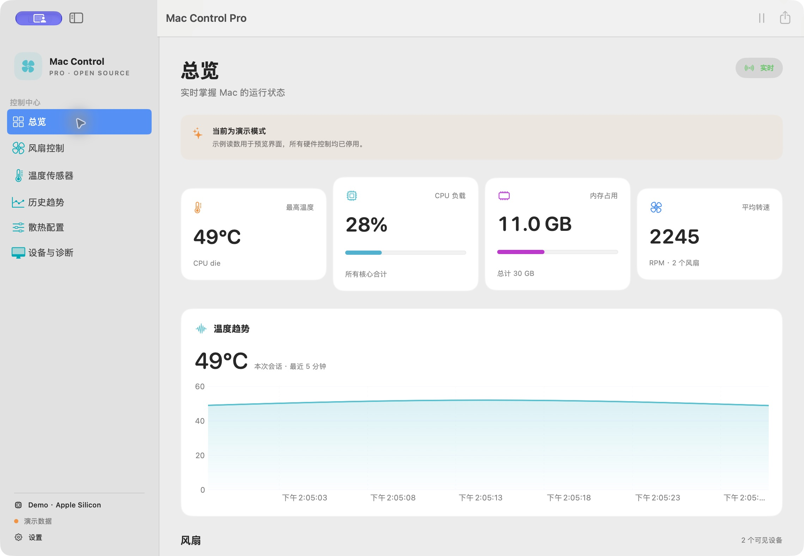

# Mac Control Pro

A fully open-source, native macOS monitor and fan-management application, built with SwiftUI and a separate opt-in privileged helper.

[Download](https://github.com/Hughhhhcoder/mac-control-pro/releases/latest) · [简体中文](README.md) · [Compatibility](docs/COMPATIBILITY.md) · [Contributing](CONTRIBUTING.md)



## Install

Requires **macOS 14 or later**. Download the universal `.dmg` from [Releases](https://github.com/Hughhhhcoder/mac-control-pro/releases/latest) and drag the app into Applications, or extract the `.zip`. Universal packages contain Apple Silicon and Intel binaries.

The initial release is ad-hoc signed and **not Apple-notarized**. If Gatekeeper blocks it, Control-click the app and choose Open, or use System Settings → Privacy & Security → Open Anyway where available. See [installation](docs/INSTALLATION.md) for checksum verification.

Monitoring does not need administrator access. Manual fan control requires the optional open-source helper:

```bash
sudo ./scripts/install-helper.sh "/Applications/Mac Control Pro.app"
```

Read [the helper design](docs/HELPER.md) before installing. Remove it with `sudo ./scripts/uninstall-helper.sh` after restoring automatic mode.

## Included

- Native SwiftUI navigation, system typography, dark/light appearance, and menu bar entry.
- Real CPU, memory, battery, thermal-state, fan and supported temperature readings.
- Session charts with CSV export, searchable sensors, shareable JSON presets, fixed RPM and multi-point temperature curves.
- Chinese / English preferences, temperature units, sampling interval, launch at login and an optional power-source rule (off by default).
- Diagnostic JSON snapshots and a clearly labeled demonstration mode.
- No account, subscription, cloud service or third-party Swift dependencies.

SMC is undocumented. Available sensors and fan writes vary by machine and OS. Missing data is reported as unavailable, never silently replaced with demonstration data. The initial release does not claim validated manual fan control on every Mac. The helper attempts to restore automatic control on lease expiry (about 12 seconds), sensor failure and high temperature; hardware failures can prevent restoration. See [compatibility](docs/COMPATIBILITY.md).

This is an independent implementation inspired by the workflow of fan-management utilities. It is not affiliated with CrystalIDEA, Macs Fan Control or Apple, and redistributes none of their proprietary software or assets. Additional charts, curves and transparency do not imply superior hardware compatibility.

## Build

Install Xcode / Command Line Tools with Swift 5.9 or later:

```bash
git clone https://github.com/Hughhhhcoder/mac-control-pro.git
cd mac-control-pro
swift test
./scripts/build-release.sh
open "dist/Mac Control Pro.app"
```

Packages, the launchable app and checksums appear in `dist/`. Set `ARCHS=arm64` for a local Apple Silicon-only build. Run the app executable with `--diagnose` for real hardware JSON, or `--demo` for explicitly simulated UI data. Read [releasing](docs/RELEASING.md) for signing and notarization.

[MIT License](LICENSE). Contributions, reproducible compatibility reports and security reviews are welcome.
