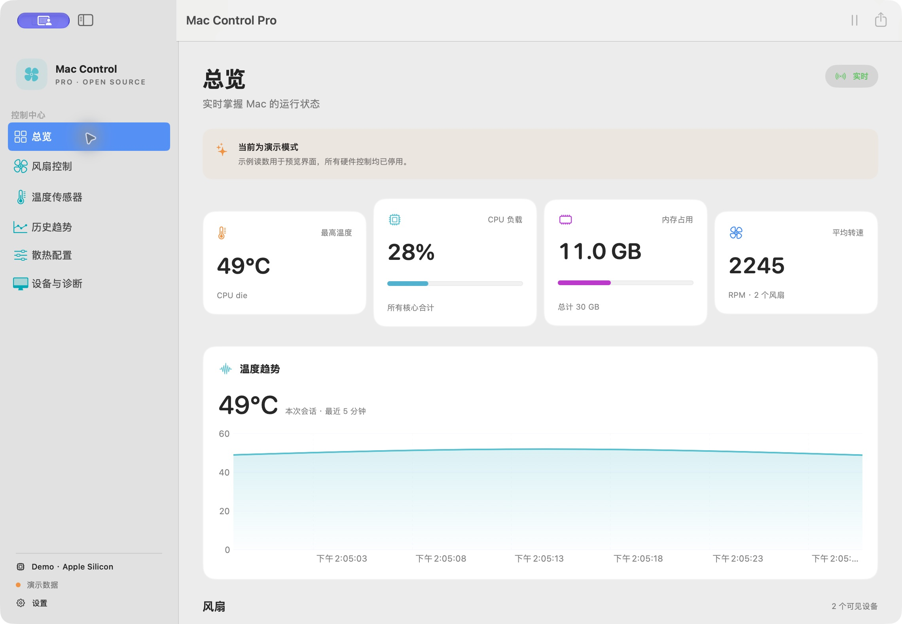

<div align="center">

# Mac Control Pro

**用原生 macOS 界面，看清温度、风扇与系统状态。**

一款独立开发、完整开源的 Mac 监控与风扇管理工具。

[](https://github.com/Hughhhhcoder/mac-control-pro/actions/workflows/ci.yml)
[](https://github.com/Hughhhhcoder/mac-control-pro/releases/latest)
[](LICENSE)
[](docs/COMPATIBILITY.md)

[下载最新版](https://github.com/Hughhhhcoder/mac-control-pro/releases/latest) · [English](README.en.md) · [兼容性](docs/COMPATIBILITY.md) · [参与开发](CONTRIBUTING.md)

</div>



## 下载与运行

在 [Releases](https://github.com/Hughhhhcoder/mac-control-pro/releases/latest) 下载 `.dmg`，打开后将 **Mac Control Pro.app** 拖入「应用程序」。也可以下载 `.zip`，解压后运行。通用版本同时包含 Apple Silicon 与 Intel 程序。

要求 **macOS 14 或更新版本**。首个版本使用临时签名（ad-hoc），尚未经过 Apple 公证。若系统拦截，请尝试按住 Control 点按应用并选择「打开」，或在「系统设置 → 隐私与安全性」中选择「仍要打开」。不同 macOS 版本的提示可能不同。[安装说明](docs/INSTALLATION.md) 包含校验和与源码构建方法。

**正常启动只读取数据，不需要管理员权限。** 如需手动转速或曲线控制，另行安装开源控制助手；安装步骤见下文。

## 功能

- **原生界面**：SwiftUI、系统侧边栏、工具栏、系统字体、深浅外观与键盘操作。
- **实时总览**：CPU 使用率、内存、电池、系统热状态、风扇与温度；当前会话图表帮助观察变化。
- **传感器浏览**：按名称、类别或 SMC 标识搜索，显示实际可读取的传感器；不可读的数据明确标注，正常模式不补入模拟值。
- **风扇管理**：自动模式、固定转速、多节点温度曲线、自定义预设与 JSON 导入导出；写入由独立的可审计控制助手执行。可选供电切换规则默认关闭。
- **菜单栏入口**：快速查看关键读数并打开主窗口。
- **偏好设置**：中文 / English、温度单位、采样间隔与登录启动。
- **导入与导出**：配置预设可通过 JSON 分享；当前会话支持 CSV 导出，诊断快照支持 JSON，也可使用 `--diagnose` 输出实际读数。
- **离线运行**：核心功能无需账号、订阅或云端服务。

本项目受到风扇管理工具使用场景启发，是独立实现；与 CrystalIDEA、Macs Fan Control 或 Apple 无隶属关系。未复制、打包或重新分发 Macs Fan Control 的二进制文件、资源或商业代码。「更强」在此指开放的源码与曲线、图表、诊断和原生工作流；不能据此推断其硬件兼容性已经超过成熟商用产品。

## 安装风扇控制助手（可选）

风扇写入需要管理员权限。先阅读 [助手设计与权限](docs/HELPER.md)，再在仓库目录运行：

```bash
sudo ./scripts/install-helper.sh "/Applications/Mac Control Pro.app"
```

脚本会把助手复制到 root 拥有的系统目录，并安装 launchd 服务，仅允许运行 `sudo` 的本机用户请求控制。安装后重新打开应用。脚本不会要求关闭 SIP，也不修改系统安全策略。

恢复 Apple 自动控制后，可卸载助手：

```bash
sudo ./scripts/uninstall-helper.sh
```

助手使用短租约管理手动模式：客户端停止续约后，约 12 秒内尝试恢复自动模式；传感器缺失、温度达到保护阈值或连接异常时会拒绝控制或触发恢复。**SMC 接口未公开，固件和硬件故障可能导致写入或恢复失败。** 具体边界与测试范围见 [兼容性](docs/COMPATIBILITY.md)。首发版本不宣称通过所有 Mac 机型的硬件控制验证。

## 从源码构建

需要包含 Swift 5.9 或更新版本的 Xcode / Command Line Tools，无第三方 Swift 包依赖。

```bash
git clone https://github.com/Hughhhhcoder/mac-control-pro.git
cd mac-control-pro
swift test
./scripts/build-release.sh
open "dist/Mac Control Pro.app"
```

构建产物位于 `dist/`：通用 `.app`、`.zip`、`.dmg` 和 `.sha256`。只为当前 Apple Silicon Mac 构建：

```bash
ARCHS=arm64 ./scripts/build-release.sh
```

诊断与演示：

```bash
"dist/Mac Control Pro.app/Contents/MacOS/MacControlPro" --diagnose
"dist/Mac Control Pro.app/Contents/MacOS/MacControlPro" --demo
```

演示模式会明确标注模拟数据，适合预览界面，不用于控制真实硬件。`--diagnose` 读取实际硬件。

## 工程结构

```text
Sources/
  CSMC/                  IOKit / SMC C 接口
  MacControlCore/        硬件读数、数据模型与风扇曲线
  MacControlHelper/      独立的特权风扇控制服务
  MacControlPro/         SwiftUI 应用与菜单栏
Tests/                   核心与助手逻辑测试
scripts/                 构建、打包与助手安装 / 卸载
docs/                    架构、安装、权限与兼容性
.github/                 CI、发布与协作模板
```

## 项目文档

- [架构](docs/ARCHITECTURE.md)：数据流、进程边界和故障处理。
- [兼容性](docs/COMPATIBILITY.md)：Apple Silicon / Intel、无风扇设备及未验证项。
- [构建与发布](docs/RELEASING.md)：通用包、签名、公证与 GitHub Release。
- [验证与测试](docs/TESTING.md)：自动化测试、只读检查、界面与硬件验证的区别。
- [路线图](docs/ROADMAP.md)：兼容性矩阵、签名发行与后续能力。
- [更新日志](CHANGELOG.md)、[安全政策](SECURITY.md)、[开源许可](LICENSE)。

欢迎提交包含机型、macOS 版本、实际读数和复现步骤的反馈。分享诊断文件前请检查其中的设备信息；不要上传用户名、序列号或其他隐私数据。
