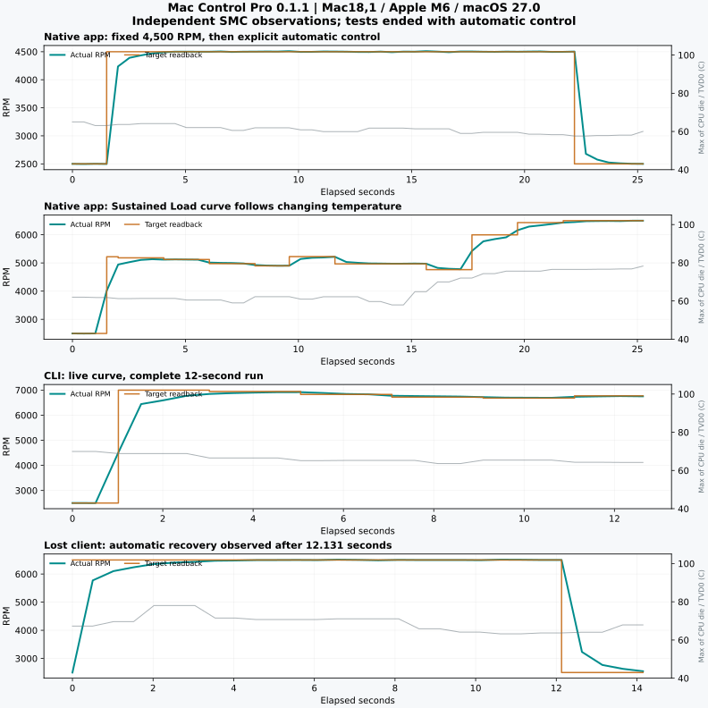

# 0.1.1 硬件调速实测

2026-11-16，在 **Mac18,1 / Apple M6 / macOS 27.0** 上安装 root 辅助服务后完成。只对这台机器作实测结论；Intel 和其他 Apple Silicon 机型尚未完成写入验证。

## 结果

| 测试 | 实际观察 | 结束状态 |
| --- | --- | --- |
| 固定 3000 RPM | 实际达到 3001 RPM；随后温度保护触发 | 自动模式，租约清空 |
| 固定 5500 RPM | 9 次请求被接受；约 16 秒手动采样，稳定读数约 5490–5505 RPM，峰值 5512 RPM；随后保护触发 | 自动模式，CLI 拒绝重新启用旧目标 |
| 原生界面固定 4500 RPM | 约 20.2 秒连续手动采样，稳定实际 4492–4510 RPM | 点击恢复自动后，独立采样观察到模式 0、约 2500 RPM |
| 原生界面曲线预设 | “持续负载”预设连续观察约 23.7 秒，目标读回从 4762 到 6500 RPM，实际随之变化 | 点击恢复自动后，界面及最终状态均确认自动模式 |
| CLI 实时温度曲线 | 使用 TCMb；40°C:5500、60°C:6500、80°C:7500；完整执行 12 秒、6 次控制采样 | 正常退出，明确恢复自动，租约清空 |
| 客户端异常消失 | 请求 6500 RPM 后仅强制结束测试 CLI，独立观察器继续读取；实际转速达到约 6500 RPM | 12.131 秒观察到自动模式，14.150 秒实际回落至 2545 RPM |
| 高温拒绝写入 | 当任一可验证温度达到 85°C 时，请求被拒绝或现有租约被回收 | 未禁用温度保护 |
| 原生界面 | 0.1.1 显示控制服务在线，点击全部恢复系统自动 | 自动模式 |

曲线请求随实测温度变化：约 6997.8 → 6943.1 → 6827.5 → 6718.8 → 6681.4 → 6771.3 RPM。实际风扇存在机械响应延迟，记录同时保留请求值与实际值，没有把请求成功当作风扇已经达到目标。

## 发现与修复

0.1.0 的第一次 3000 RPM 请求被误判失败：底层写入返回成功，但立即读取 `F0Tg` 时仍是先前的 2500 RPM，随后错误路径恢复了自动控制。

0.1.1 对目标转速寄存器加入最长 **0.8 秒**、使用单调时钟的有界回读确认，每 25 毫秒重读；模式和 `Ftst` 仍保留严格确认，传输/固件错误和确认超时仍触发回滚。等待上限低于当前 2 秒 IPC 接收期限，但这不是内核 I/O 调用的硬实时保证。

该修复基于本机观察，并参考 [Fan Control 的目标读回记录](https://github.com/adilkairolla/fan-control#smc-notes) 与 [Stats 的 SMC 控制实现](https://github.com/exelban/stats/blob/master/SMC/smc.swift)。协议事实用于研究，没有复制这些项目的代码。

CLI 还会在续约前检查助手仍持有该风扇的租约。助手因温度保护交还控制后，测试会停止并请求恢复自动，避免继续发送旧目标。该路径在 3000 和 5500 RPM 实测中均触发。

## 可复核记录

- [3000 RPM 独立读取](validation/fixed-3000.csv)
- [5500 RPM 独立读取](validation/fixed-5500.csv)
- [原生界面固定 4500 RPM](validation/gui-fixed-4500.csv)、[原生界面曲线](validation/gui-curve.csv)
- [曲线独立读取](validation/curve.csv)、[曲线请求与恢复记录](validation/curve-commands.csv)
- [客户端消失后的独立读取](validation/lease-timeout.csv)

CSV 仅保留相对时间、风扇转速、模式和两项温度，没有账号、序列号、UUID 或完整系统报告。独立观察器通过单独的只读 SMC 连接采样，既不续约也不写入硬件。CLI 曲线结束后的恢复结果同时由 CLI 的硬件读取和助手租约状态确认。原生曲线的独立采样在点击恢复前结束；恢复操作后界面显示系统自动、约 2502 RPM，最终独立状态查询确认租约为空。图中不补入未采样的点。

本次构建与测试使用本机 Swift 6.4.2；通用发行包由 GitHub Actions 另行构建与校验。单机成功不代表所有固件都遵循相同的 SMC 行为。
